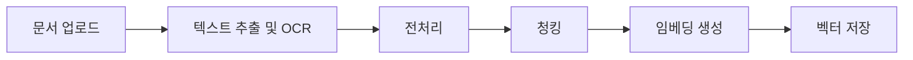
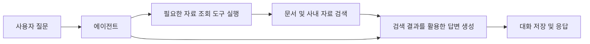

<p align="center">
  
</p>

<h3 align="center">
  생성형 AI 기반 문서·뉴스 분석 및 기사 작성 지원 서비스
</h3>

<p align="center">
  DeepBrief는 문서 업로드부터 내용 분석, 질의응답, 기사 검토와 편집까지 하나의 작업 흐름으로 지원하는 서비스입니다. 
</p>

<p align="center">
  업로드한 문서와 조직 내 자료를 활용해 질문에 답하고, 기사 작성에 필요한 제목·키워드·아이디어를 추천합니다.
</p>

</br>

## 프로젝트 개요

### 소개

> 개발 기간: 9/18 ~ 10/27

- DeepBrief는 언론사에서 기사 작성과 분석을 지원하기 위해 개발한 서비스로,
- ​프로젝트 이름인 DeepBrief에는 깊이 있게 분석하고 핵심 내용은 간결하게 전달한다는 의미를 담았습니다.​
- 기사를 분석하고 작성하는 과정에서는 자료의 내용을 파악하고 관련 자료를 찾아 비교하며,
- 조직의 작성 기준에 맞게 내용을 다듬는 작업이 반복됩니다.
- DeepBrief는 이러한 작업을 한곳에서 수행할 수 있도록 문서 처리 기능과 AI 기반 분석·작성 지원 기능을 제공합니다. 
- 개인 자료와 사내 공유 자료를 구분해 관리하고 조직별 템플릿과 지침을 활용할 수 있도록 구성했습니다.

### 주요 사용자

- 문서와 뉴스의 핵심 내용을 빠르게 파악하려는 사용자
- 기존 자료를 참고해 기사를 검토하고 작성하려는 사용자
- 조직의 기사·템플릿·지침을 관리하는 관리자

### 주요 기능

| 기능 | 설명 |
| --- | --- |
| 문서 업로드 및 OCR | 문서에서 텍스트를 추출하고 분석에 사용할 수 있도록 전처리합니다. |
| 문서 기반 질의응답 | 업로드한 문서와 접근 가능한 사내 자료를 활용해 질문에 답합니다. |
| 기사 중복 검토 | 기존 기사와의 유사성을 확인해 중복 검토를 지원합니다. |
| 기사 평가 | 기사 내용을 분석하고 검토 결과를 제공합니다. |
| 작성 지원 | 제목, 키워드, 헤드라인, 기사 아이디어를 제공합니다. |
| 템플릿 기반 편집 | 조직별 템플릿을 활용해 기사를 정리하고 편집합니다. |
| 개인·사내 보관함 | 개인 기사와 사내 공유 기사를 구분해 조회합니다. |
| 대화 관리 | 기사와 연결된 대화를 조회하고 삭제할 수 있습니다. |
| 관리자 기능 | 조직 정보, 회원, 기사, 템플릿 및 지침을 관리합니다. |

</br>

## 서비스 화면 및 사용 흐름

### 1. 회원가입 및 로그인

사용자는 회원가입 후 로그인하여 서비스를 이용합니다. 인증 토큰을 통해 로그인 상태를 관리하고, 사용자 권한에 따라 접근 가능한 화면과 기능을 구분합니다.


### 2. 문서 업로드

문서를 업로드하면 텍스트 추출과 전처리를 거쳐 기사와 연결된 대화를 생성합니다.

> - 지원 파일 형식: PDF, PNG, JPG, JPEG, TXT, MD
> - 최대 업로드 크기: 20MB


### 3. 문서 분석 및 기사 작성 지원

대화 화면에서 문서 내용에 관해 질문하거나 기사 검토·추천·편집 기능을 사용할 수 있습니다.

- 문서 및 사내 자료 기반 질의응답
- 기사 중복 검토와 평가
- 제목·키워드·헤드라인·아이디어 추천
- 조직별 템플릿을 활용한 기사 편집


### 4. 개인/사내 보관함

내 보관함에서 개인 기사를 확인하고, 사내 보관함에서 조직 내 공유 기사를 조회할 수 있습니다. 기존 기사를 선택해 상세 내용을 확인할 수 있습니다.


### 5. 관리자 화면

관리자는 조직 정보와 회원을 관리하고, 조직의 기사·템플릿·지침을 조회하거나 수정할 수 있습니다.


</br>

## 시스템 아키텍처

DeepBrief는 React 기반 프론트엔드, FastAPI 기반 백엔드, 관계형 DB 및 벡터 검색 계층으로 구성됩니다. 백엔드는 인증과 데이터 관리를 담당하고, 문서 처리 및 AI 모델 호출을 연결합니다.

[실제 구성에 맞춘 시스템 아키텍처 이미지]

### 문서 처리 흐름



문서에서 추출한 텍스트를 전처리하고 청크 단위로 나눈 뒤, 임베딩을 생성해 검색에 활용합니다. 기사·파일·사용자·대화 등의 정보는 관계형 DB에서 관리합니다.

### 질의응답 흐름



에이전트는 질문에 따라 자료 조회 도구의 사용 여부를 판단하고, 필요한 경우 검색 결과를 활용해 답변을 생성합니다.

</br>

## 기술 스택

## 기술 스택

| 구분 | 사용 기술 |
| --- | --- |
| Frontend |     |
| Backend |   |
| ORM / Migration |   |
| 관계형 DB |  |
| 벡터 저장 및 검색 |  |
| DB 서비스 |  |
| LLM | Qwen3-1.7B |
| Embedding | BAAI/bge-m3 |
| OCR | PyMuPDF, PaddleOCR |
| 모델 학습 |   |
| AI 워크플로 |  |
| 테스트 |  |
| 협업 |     |

</br>

## AI 모델 및 데이터

### 기능별 모델 구성

| 용도 | 모델 | 선정 이유 |
| --- | --- | --- |
| 질의응답 | [모델명] | [선정 이유] |
| 요약 및 헤드라인 추출 | [모델명] | [선정 이유] |
| 기사 검토·추천·편집 | [모델명] | [선정 이유] |
| 문서 임베딩 | [모델명] | [선정 이유] |
| OCR | [모델명] | [선정 이유] |

### 임베딩 모델 선정

문서 검색에 적합한 임베딩 모델을 선정하기 위해 [비교한 모델 목록]을 비교했습니다.

- 평가 데이터: [데이터 출처 및 규모]
- 평가 방법: [검색 평가 방식과 지표]
- 고려 사항: [한국어 성능, 검색 정확도, 처리 속도, 자원 사용량 등 실제 기준]
- 최종 선정 모델: [모델명]

[모델별 비교 결과 표 또는 그래프]

### 요약·QA 파인튜닝

요약과 질의응답을 위한 데이터 준비 및 학습 코드를 구성했습니다. 학습 관련 코드는 `backend/fine_tuning/summary`와 `backend/fine_tuning/qa`에서 관리합니다.

| 항목 | 요약 | 질의응답 |
| --- | --- | --- |
| 기반 모델 | [모델명] | [모델명] |
| 데이터 출처 | [데이터 출처] | [데이터 출처] |
| 학습 데이터 수 | [데이터 수] | [데이터 수] |
| 검증 데이터 수 | [데이터 수] | [데이터 수] |
| 학습 방식 | [학습 방식] | [학습 방식] |
| 평가 방법 | [평가 지표 및 방법] | [평가 지표 및 방법] |
| 서비스 적용 여부 | [적용 여부] | [적용 여부] |

[학습 결과와 해석 — 학습 손실, 검증 결과, 실제 응답 비교 등을 작성]

</br>

## 시작하기

### 실행 요구 사항

- Python 3.13
- Node.js [버전]
- [관계형 DB 및 버전]
- [벡터 검색에 필요한 확장 기능 또는 별도 서비스]
- [로컬 모델 실행에 필요한 GPU·메모리·저장 공간]
- [외부 모델 API를 사용하는 경우 필요한 계정 및 API 키]

### 1. 저장소 복제

```bash
git clone https://github.com/TDD-main-project-team2/deepbrief.git
cd deepbrief
```

### 2. 백엔드 의존성 설치

가상환경을 생성하고 활성화합니다.

```bash
python -m venv .venv
```

macOS / Linux:

```bash
source .venv/bin/activate
```

Windows PowerShell:

```powershell
.\.venv\Scripts\Activate.ps1
```

의존성을 설치합니다.

```bash
pip install -r backend/requirements.txt
```

### 3. 환경 변수 설정

루트 디렉터리의 `.env.example`을 복사해 `.env` 파일을 생성합니다.

```bash
cp .env.example .env
```

`.env.example`에 정의된 항목을 실행 환경에 맞게 설정합니다.

| 설정 영역 | 설명 |
| --- | --- |
| DB 연결 | [환경 변수명 및 설정 예시] |
| 인증 | [환경 변수명 및 설정 방법] |
| AI 모델 | [환경 변수명, API 키 또는 모델 경로 설정] |
| 임베딩 | [환경 변수명 및 모델 설정] |
| OCR | `OCR_DEVICE` 등 OCR 실행 설정 |
| 파일 저장 | [환경 변수명 및 저장 경로 설정] |
| 프론트엔드 API 연결 | [환경 변수명과 설정 파일 위치] |

API 키, DB 비밀번호 등 비밀 정보가 포함된 `.env` 파일은 저장소에 커밋하지 않습니다.

### 4. DB 준비 및 마이그레이션

[DB 생성, 사용자 권한, 벡터 검색 확장 기능 등 사전 준비 절차]

프로젝트 루트에서 마이그레이션을 실행합니다.

```bash
alembic upgrade head
```

### 5. 모델 및 어댑터 준비

[모델 다운로드 방법, 어댑터 제공 위치, 저장 경로와 접근 권한 설정]

[외부 API를 사용하는 기능과 로컬 모델이 필요한 기능을 구분해 설명]

### 6. 백엔드 실행

프로젝트 루트에서 실행합니다.

```bash
uvicorn backend.app.main:app --reload
```

- API 서버: [실제 접속 주소]
- API 문서: [실제 API 문서 주소]

### 7. 프론트엔드 실행

새 터미널에서 실행합니다.

```bash
cd frontend
npm ci
npm run dev
```

브라우저에서 [프론트엔드 접속 주소]로 접속합니다.

### 8. 최초 조직 및 관리자 설정

[최초 조직·관리자 생성 방법, 초대 코드 또는 관리자 코드 발급 절차]

</br>

## 프로젝트 구조

```text
deepbrief/
├── backend/
│   ├── app/                 # FastAPI 앱, API 라우터 및 의존성
│   ├── alembic/             # DB 마이그레이션
│   ├── database/            # 관계형 DB 연결 및 벡터 검색
│   ├── fine_tuning/         # 요약·QA 데이터 준비 및 학습
│   ├── models/              # DB 모델
│   ├── repositories/        # DB 조회 및 변경
│   ├── schemas/             # 요청·응답 스키마
│   └── services/
│       ├── agent/           # 에이전트 흐름 및 도구
│       ├── ai/              # 모델 호출 및 임베딩
│       ├── auth/            # 인증 및 관리자 기능
│       ├── document/        # OCR, 전처리 및 청킹
│       ├── features/        # 검토·추천·편집·질의응답
│       ├── rag/             # 검색 기반 생성
│       └── resources/       # 기사·대화·조직 관리
├── frontend/
│   └── src/
│       ├── api/             # API 요청 및 인증 처리
│       ├── components/      # 사용자·관리자·공통 컴포넌트
│       ├── config/          # 메뉴 및 기능 설정
│       ├── hooks/           # 공통 상태 및 작업 흐름
│       ├── pages/           # 주요 페이지
│       └── utils/           # 데이터 변환 및 유틸리티
├── tests/                   # 백엔드 테스트
├── .env.example             # 환경 변수 예시
└── alembic.ini              # 마이그레이션 설정
```

</br>

## 기타

### 조직별 기사 중복 판별

동일한 콘텐츠의 등록 여부를 조직 단위로 판단하도록 조직 ID와 콘텐츠 해시를 함께 사용했습니다. DB에도 복합 유니크 제약을 적용해 조직별 중복 등록을 제한합니다.

### 검색 및 에이전트 구성

문서를 청크 단위로 나누고 임베딩 검색에 활용하며, 에이전트가 질문에 따라 사내 자료 조회 도구를 사용할 수 있도록 구성했습니다.

[청킹 기준, 검색 방식, 도구 구성 및 설계 이유]

### 연관 데이터 삭제

기사와 사용자 삭제 시 연결된 대화·메시지·파일 등의 관계를 고려해 삭제 로직을 구성했습니다.

### 추가 문제 해결 사례

[문제 상황 → 원인 → 해결 방법 → 결과 순서로 작성]

</br>

## 팀원 및 역할

| 이름 | 담당 영역 | 주요 기여 |
| --- | --- | --- |
| [이름] | [담당 영역] | [주요 구현 및 기여] |
| [이름] | [담당 영역] | [주요 구현 및 기여] |
| [이름] | [담당 영역] | [주요 구현 및 기여] |
| [이름] | [담당 영역] | [주요 구현 및 기여] |

</br>

## 한계 및 향후 개선

### 현재 한계

[실제로 확인된 제약 사항 — 지원 문서 형식, OCR 품질, 응답 지연, 검색 정확도, 실행 자원 등]

### 향후 개선

[팀에서 합의한 개선 계획과 우선순위]

</br>

## 라이선스

[프로젝트 라이선스 및 사용 모델·데이터의 라이선스 관련 안내]
