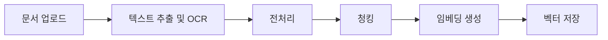
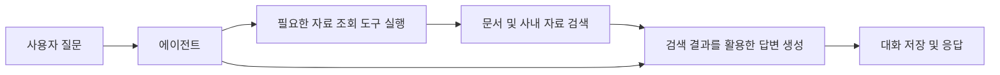

<p align="center">
  
</p>

<h3 align="center">
  생성형 AI 기반 문서·뉴스 분석 및 기사 작성 지원 서비스
</h3>

</br>

# 팀원 및 역할

> 개발 기간: 9/18 ~ 10/27

<table>
  <thead>
    <tr>
      <th align="center" width="25%"><a href="https://github.com/ojm51">오정민</a></th>
      <th align="center" width="25%"><a href="https://github.com/royonem">명원식</a></th>
      <th align="center" width="25%"><a href="https://github.com/JYJmk2">장영진</a></th>
      <th align="center" width="25%"><a href="https://github.com/jmh0930">황재민</a></th>
    </tr>
  </thead>
  <tbody>
    <tr>
      <td align="center">
        
      </td>
      <td align="center">
        
      </td>
      <td align="center">
        
      </td>
      <td align="center">
        
      </td>
    </tr>
    <tr>
      <td valign="top">
        - DB (Relation, Migration)<br>
        - Fine-Tuning (Summary)<br>
        - Embedding<br>
        - Backend (Auth Token)<br>
        - Frontend (User page, API, Refactoring)
      </td>
      <td valign="top">
        - DB (Vector, Cloud, Supabase)<br>
        - Fine-Tuning (Summary)<br>
        - RAG, Agent (Workflow)<br>
        - Backend (API, Service)<br>
        - Frontend (Admin page)
      </td>
      <td valign="top">
        - DB (Management)<br>
        - Fine-Tuning (QA)<br>
        - DOC (Preprocessing, Chunking)<br>
        - LLM<br>
        - Backend (Auth Management, Repository, Schema)
      </td>
      <td valign="top">
        - DB (Data)<br>
        - Fine-Tuning (QA)<br>
        - DOC (OCR), Agent (Tool)<br>
        - Prompt Engineering<br>
        - Backend (Auth Security)
      </td>
    </tr>
  </tbody>
</table>

</br>

# 프로젝트 개요

### 소개

- DeepBrief는 언론사에서 기사 작성과 분석을 지원하기 위해 개발한 서비스로,
- ​프로젝트 이름인 DeepBrief에는 깊이 있게 분석하고 핵심 내용은 간결하게 전달한다는 의미를 담았습니다.​
- 기사를 분석하고 작성하는 과정에서는 자료의 내용을 파악하고 관련 자료를 찾아 비교하며, 조직의 작성 기준에 맞게 내용을 다듬는 작업이 반복됩니다.
- DeepBrief는 이러한 작업을 한곳에서 수행할 수 있도록 문서 처리 기능과 AI 기반 분석·작성 지원 기능을 제공합니다. 
- 개인 자료와 사내 공유 자료를 구분해 관리하고 조직별 템플릿과 지침을 활용할 수 있도록 구성했습니다.

### 주요 사용자

- 문서와 뉴스의 핵심 내용을 빠르게 파악하려는 사용자
- 기존 자료를 참고해 기사를 검토하고 작성하려는 사용자
- 조직의 기사·템플릿·지침을 관리하는 관리자

### 주요 기능

| 기능 | 설명 |
| --- | --- |
| 문서 업로드 및 OCR | 문서에서 텍스트를 추출하고 분석에 사용할 수 있도록 전처리합니다. |
| 문서 기반 질의응답 | 업로드한 문서와 접근 가능한 사내 자료를 활용해 질문에 답합니다. |
| 기사 중복 검토 | 기존 기사와의 유사성을 확인해 중복 검토를 지원합니다. |
| 기사 평가 | 사내 가이드라인을 기반으로 기사 내용을 분석하고 검토 결과를 제공합니다. |
| 작성 지원 | 제목, 키워드, 헤드라인, 기사 아이디어를 제공합니다. |
| 템플릿 기반 편집 | 조직별 템플릿을 활용해 기사를 정리하고 편집합니다. |
| 개인·사내 보관함 | 개인 기사와 사내 공유 기사를 구분해 조회합니다. |
| 대화 관리 | 기사와 연결된 대화를 조회하고 삭제할 수 있습니다. |
| 관리자 기능 | 조직 정보, 회원, 기사, 템플릿 및 지침을 관리합니다. |

</br>

# 서비스 화면

### 1. 회원가입 및 로그인

사용자는 회원가입 후 로그인하여 서비스를 이용합니다. 인증 토큰을 통해 로그인 상태를 관리하고, 사용자 권한에 따라 접근 가능한 화면과 기능을 구분합니다.


### 2. 문서 업로드

문서를 업로드하면 텍스트 추출과 전처리를 거쳐 기사와 연결된 대화를 생성합니다.

> - 지원 파일 형식: PDF, PNG, JPG, JPEG, TXT, MD
> - 최대 업로드 크기: 20MB


### 3. 문서 분석 및 기사 작성 지원

대화 화면에서 문서 내용에 관해 질문하거나 기사 검토·추천·편집 기능을 사용할 수 있습니다.

- 문서 및 사내 자료 기반 질의응답
- 기사 중복 검토와 가이드라인 기반 평가
- 제목·키워드·헤드라인·아이디어 추천
- 조직별 템플릿을 활용한 기사 편집


### 4. 개인/사내 보관함

내 보관함에서 개인 기사를 확인하고, 사내 보관함에서 조직 내 공유 기사를 조회할 수 있습니다. 기존 기사를 선택해 상세 내용을 확인할 수 있습니다.


### 5. 관리자 화면

관리자는 조직 정보와 회원을 관리하고, 조직의 기사·템플릿·지침을 조회하거나 수정할 수 있습니다.


</br>
</br>

# 시스템 아키텍처

DeepBrief는 React 기반 프론트엔드, FastAPI 기반 백엔드, 관계형 DB 및 벡터 검색 계층으로 구성됩니다. 
백엔드는 인증과 데이터 관리를 담당하고, 문서 처리 및 AI 모델 호출을 연결합니다.


### 문서 처리 흐름



문서에서 추출한 텍스트를 전처리하고 청크 단위로 나눈 뒤, 임베딩을 생성해 검색에 활용합니다. 기사·파일·사용자·대화 등의 정보는 관계형 DB에서 관리합니다.

### 질의응답 흐름



에이전트는 질문에 따라 자료 조회 도구의 사용 여부를 판단하고, 필요한 경우 검색 결과를 활용해 답변을 생성합니다.

</br>

# 기술 스택

| 구분 | 사용 기술 |
| --- | --- |
| Frontend |     |
| Backend |   |
| ORM / Migration |   |
| 관계형 DB |  |
| 벡터 저장 및 검색 |  |
| DB 서비스 |  |
| 모델 학습 |   |
| AI 워크플로 |  |
| 테스트 |  |
| 협업 |     |

</br>

# AI 모델 및 데이터

### 기능별 모델 구성

| 용도 | 모델 |
| --- | --- |
| OCR | PyMuPDF, PaddleOCR |
| Embedding | bge-m3 |
| LLM | Qwen3-1.7B |

### Summary / QA 파인튜닝

> 학습 관련 코드는 `backend/fine_tuning/summary`와 `backend/fine_tuning/qa`에서 관리합니다.

기본 모델 대신 LoRA 어댑터를 학습하며, 정답 응답 부분에만 손실을 계산합니다.​

Summary의 경우 학습률 0.0001로 1epoch 학습을 진행했지만 만족스러운 결과를 얻지 못했기에, ​학습률을 0.00005로 낮춘 후 1epoch 학습을 진행하여 총 2epoch에 걸쳐 학습했습니다.​
QA의 경우 학습률 0.0001을 유지하면서 총 2epoch 학습을 진행했습니다.

| 항목 | Summary | QA |
| --- | --- | --- |
| 모델 | Qwen3-1.7B | Qwen3-1.7B |
| 데이터 출처 | [요약문 및 레포트 생성](https://aihub.or.kr/aihubdata/data/view.do?pageIndex=1&currMenu=115&topMenu=100&srchOptnCnd=OPTNCND001&searchKeyword=요약문+및+레포트+생성+데이터&srchDetailCnd=DETAILCND001&srchOrder=ORDER001&srchPagePer=20&aihubDataSe=data&dataSetSn=582)</br> | [뉴스 기사 기계독해](https://www.aihub.or.kr/aihubdata/data/view.do?pageIndex=1&currMenu=115&topMenu=100&srchOptnCnd=OPTNCND001&searchKeyword=뉴스+기사+기계독해+데이터&srchDetailCnd=DETAILCND001&srchOrder=ORDER001&srchPagePer=20&aihubDataSe=data&dataSetSn=577) |
| 학습 데이터 수 | 20,000 | 20,000 |
| 검증 데이터 수 | 2,000 | 2,000 |
| 학습 방식 | QLoRA 기반 지도 미세조정(SFT) | QLoRA 기반 지도 미세조정(SFT) |
| 평가 데이터 수 | 400 | 400 |

> Summary 학습에 사용한 데이터는 '요약문 및 레포트 생성 데이터'의 `라벨링 데이터 > VL1 > 01.news_r + 02.briefing + 06.edit > summary3`을 사용

### 파인튜닝 설정값

| 항목 | 설정값 |
| --- | --- |
| 기반 모델 | Qwen/Qwen3-1.7B |
| 학습 방식 | QLoRA 기반 SFT |
| 양자화 | 4-bit NF4, Double Quantization |
| LoRA Rank / Alpha | 8 / 32 | 
| LoRA Dropout | 0.1 |
| 적용 모듈 | q_proj, k_proj, v_proj, o_proj |
| Epoch | 1 |
| 배치 크기 / 경사 누적 횟수 | 4 / 4 |
| 학습률 | 0.0001(0.00005) | 
| 최대 시퀀스 길이 | 1,400 토큰 |
| Optimizer | paged_adamw_8bit |
| 체크포인트 선택 기준 | 검증 손실이 가장 낮은 체크포인트 |

</br>

# 시작하기

### 실행 요구 사항

- Python 3.13(26.10.28 기준 PaddleOCR이 지원하는 파이썬 버전)
- Node.js 24.21.0(개발 환경 기준)
- Supabase 프로젝트
  - `vector` 확장 기능 활성화 필요
- AI 모델 실행에 필요한 파일
  - Summary 및 QA 파인튜닝 어댑터(현재 깃허브 저장소에는 업로드 하지 않음)

### 1. 저장소 복제

```bash
git clone https://github.com/TDD-main-project-team2/deepbrief.git
cd deepbrief
```

### 2. 백엔드 의존성 설치

가상환경을 생성하고 활성화합니다.

```bash
python -m venv .venv
```

macOS / Linux:

```bash
source .venv/bin/activate
```

Windows PowerShell:

```powershell
.\.venv\Scripts\Activate.ps1
```

의존성을 설치합니다.

```bash
pip install -r backend/requirements.txt
```

### 3. 환경 변수 설정

루트 디렉터리의 `.env.example`을 복사해 `.env` 파일을 생성합니다.

```bash
cp .env.example .env
```

`.env.example`에 정의된 항목을 실행 환경에 맞게 설정합니다.
API 키, DB 비밀번호 등 비밀 정보가 포함된 `.env` 파일은 저장소에 커밋하지 않습니다.

### 4. DB 준비 및 마이그레이션

프로젝트 루트에서 마이그레이션을 실행합니다.

```bash
alembic upgrade head
```

### 5. 모델 및 어댑터 준비

[모델 어댑터 파일](https://drive.google.com/file/d/1UFL8xR4jjjk9wshs5M3kd8yRfyMo1_uP/view?usp=share_link)

> 드라이브에서 어댑터 파일을 다운받아 `backend/fine_tuning/qa/README.md`와 `backend/fine_tuning/summary/README.md`를 참고해 필요한 파일 삽입

### 6. 백엔드 실행

프로젝트 루트에서 실행합니다.

```bash
uvicorn backend.app.main:app --reload
```

- [API 서버 주소](http://127.0.0.1:8000/)
- [API 문서](http://127.0.0.1:8000/docs)

### 7. 프론트엔드 실행

새 터미널에서 실행합니다.

```bash
cd frontend
npm ci
npm run dev
```

브라우저에서 [프론트엔드 접속 주소](http://localhost:5173/)로 접속합니다.

### 8. 테스트 계정

| 타입 | 아이디 | 비밀번호 | 비고
| --- | --- | --- | --- |
| 일반 사용자 | example@test.com | 12345678 | 프로젝트 실행 시 기본으로 채워짐 |
| 조직 관리자 | admin@test.com | Test1234! | - |

</br>

# 프로젝트 구조

```text
deepbrief/
├── backend/
│   ├── app/                 # FastAPI 앱, API 라우터 및 의존성
│   ├── alembic/             # DB 마이그레이션
│   ├── database/            # 관계형 DB 연결 및 벡터 검색
│   ├── fine_tuning/         # 요약·QA 데이터 준비 및 학습
│   ├── models/              # DB 모델
│   ├── repositories/        # DB 조회 및 변경
│   ├── schemas/             # 요청·응답 스키마
│   └── services/
│       ├── agent/           # 에이전트 흐름 및 도구
│       ├── ai/              # 모델 호출 및 임베딩
│       ├── auth/            # 인증 및 관리자 기능
│       ├── document/        # OCR, 전처리 및 청킹
│       ├── features/        # 검토·추천·편집·질의응답
│       ├── rag/             # 검색 기반 생성
│       └── resources/       # 기사·대화·조직 관리
├── frontend/
│   └── src/
│       ├── api/             # API 요청 및 인증 처리
│       ├── components/      # 사용자·관리자·공통 컴포넌트
│       ├── config/          # 메뉴 및 기능 설정
│       ├── hooks/           # 공통 상태 및 작업 흐름
│       ├── pages/           # 주요 페이지
│       └── utils/           # 데이터 변환 및 유틸리티
├── tests/                   # 백엔드 테스트
├── .env.example             # 환경 변수 예시
└── alembic.ini              # 마이그레이션 설정
```

</br>
